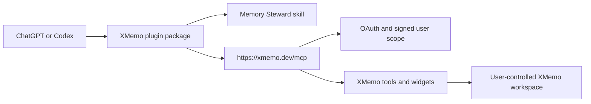

<div align="center">
  
  <h1>XMemo for ChatGPT and Codex</h1>
  <p><strong>Durable project memory and cross-agent continuity.</strong></p>
</div>

XMemo gives ChatGPT and Codex a private, user-controlled workspace for work that should survive a single conversation. Preserve decisions, project context, approved plans, TODOs, progress checkpoints, and handoff briefs; recall what matters when work resumes; and keep compatible AI agents aligned through the same XMemo account.

This repository is the public release layer for the XMemo OpenAI integration. It packages the installable plugin identity, the XMemo Memory Steward skill, product metadata, screenshots, submission evidence, and release automation. The production MCP service, OAuth flow, tool handlers, and hosted widget resources remain in the private `memory-os` runtime so there is one authoritative server implementation.

## What it enables

- Resume a project from its latest verified state instead of reconstructing context from chat history.
- Save durable decisions and rationale without archiving raw transcripts.
- Review a new plan or another agent's progress against previously approved context.
- Turn concrete follow-up actions into XMemo TODOs and structured project work.
- Prepare reliable handoffs between ChatGPT, Codex, Claude, and other compatible agents.
- Open XMemo's TODO Board, Ledger, and Project Workspace widgets in supported ChatGPT surfaces.

## Repository layout

```text
.agents/plugins/marketplace.json       Repository marketplace entry
plugins/xmemo/                         Installable XMemo plugin package
  .codex-plugin/plugin.json            Stable plugin identity and directory metadata
  .mcp.json                            Production XMemo MCP endpoint
  skills/xmemo-memory-steward/         Professional memory workflow
  assets/                              Icons and compliant product screenshots
submission/                            Submitted ChatGPT review snapshot
docs/                                  Architecture and release documentation
scripts/                               Validation and packaging tools
```

## Architecture



The plugin is the versioned installable product. The MCP service is its hosted runtime. They are released and tested together, but deploy independently so packaging changes do not duplicate or fork server logic.

## Install for local evaluation

Add this repository as a plugin marketplace, then install `xmemo` from the `XMemo` marketplace. Authentication is completed through XMemo OAuth at install or first connection; never place credentials in this repository.

The public ChatGPT listing is distributed through OpenAI's plugin directory after review. A repository checkout is not required for directory users.

## Validation

```powershell
python scripts/validate_repo.py
```

The validator checks manifests, referenced files, the MCP endpoint declaration, the submission schema, tool/test counts, and common credential patterns. GitHub Actions runs the same gate on pushes, pull requests, and version tags.

## Release model

Versions use semantic versioning. A tag such as `v1.0.0` must match `plugins/xmemo/.codex-plugin/plugin.json`; the release workflow validates the repository and publishes a deterministic plugin ZIP.

## Security and privacy

- OAuth and server-enforced authorization keep operations within the signed-in user's XMemo workspace.
- No bearer tokens, reviewer passwords, cookies, or production secrets belong in this repository.
- Submission screenshots and test descriptions use synthetic data.
- See [SECURITY.md](SECURITY.md), [PRIVACY.md](PRIVACY.md), and the [XMemo Privacy Policy](https://xmemo.dev/legal/privacy).

## License

MIT. See [LICENSE](LICENSE).
