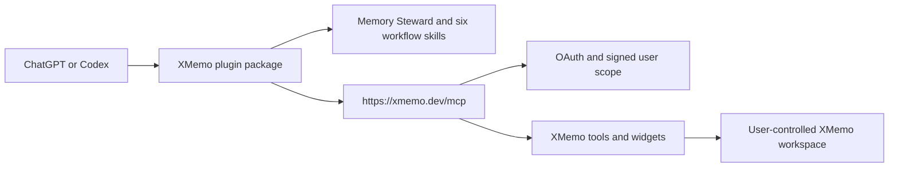

<div align="center">
  
  <h1>XMemo for ChatGPT and Codex</h1>
  <p><strong>Save and recall memory across conversations.</strong></p>
</div>

XMemo gives ChatGPT and Codex user-controlled memory for personal preferences, useful knowledge, decisions, and work that should survive a single conversation. Preserve decisions, project context, approved plans, TODOs, progress checkpoints, and handoff briefs; recall what matters when work resumes; and keep compatible AI agents aligned through the same XMemo account.

This repository is the public release layer for the XMemo OpenAI integration. It packages the installable plugin identity, the XMemo memory skills, product metadata, screenshots, submission evidence, and release automation. The production MCP service, OAuth flow, tool handlers, and hosted widget resources remain in the private `memory-os` runtime so there is one authoritative server implementation.

## What it enables

- Save personal preferences, useful knowledge, decisions, and lessons for later conversations.
- Recall what you previously saved, with relevant sources and honest handling of missing or stale results.
- Resume a project from its latest verified state instead of reconstructing context from chat history.
- Save durable decisions and rationale without archiving raw transcripts.
- Review a new plan or another agent's progress against previously approved context.
- Turn concrete follow-up actions into XMemo TODOs and structured project work.
- Prepare reliable handoffs between ChatGPT, Codex, Claude, and other compatible agents.
- Open XMemo's TODO Board, Ledger, and Project Workspace widgets in supported ChatGPT surfaces.

## Professional skills

The 1.0.2 candidate packages seven skills: one general Memory Steward and six
focused workflows. Memory Steward handles basic saving and recall directly,
chooses the appropriate tools, and guides specialized work to companion skills.
All use the same public XMemo tool contract; there are no hidden tools or
background jobs.

| Skill | Workflow |
| --- | --- |
| `xmemo-memory-steward` | Save, recall, apply, correct, and manage general memory; select tools and companion skills. |
| `xmemo-brainstorm` | Recall constraints, explore distinct options, challenge assumptions, and preserve only the approved direction. |
| `xmemo-plan-project` | Produce evidence-gated `PROJECT_PLAN.md` and `EXECUTION_PLAN.md` artifacts. |
| `xmemo-review-plan` | Review a proposal against saved decisions, risks, and acceptance criteria. |
| `xmemo-audit-progress` | Verify progress claims against plans, files, tests, deployments, and other evidence. |
| `xmemo-distill-session` | Convert an important conversation into durable decisions, actions, and unfinished state. |
| `xmemo-work-continuity` | Resume work, prepare a handoff, or reconcile a received handoff with verified state and next action. |

This package intentionally contains no Hooks. Checkpoints and memory
writes require explicit saving intent or clearly authorized persistence; skill
activation alone does not authorize a write.

## Repository layout

```text
.agents/plugins/marketplace.json       Repository marketplace entry
plugins/xmemo/                         Installable XMemo plugin package
  .codex-plugin/plugin.json            Stable plugin identity and directory metadata
  .mcp.json                            Production XMemo MCP endpoint
  skills/                              One Memory Steward and six focused workflows
  assets/                              Icons and compliant product screenshots
submission/                            Submitted ChatGPT review snapshot
docs/                                  Architecture and release documentation
scripts/                               Validation and packaging tools
```

## Architecture



The plugin is the versioned installable product. The MCP service is its hosted runtime. They are released and tested together, but deploy independently so packaging changes do not duplicate or fork server logic.

## Install for local evaluation

Add this repository as a plugin marketplace, then install XMemo (`app-6a112deb1d4881919bde555b7c16b24b`) from the `XMemo` marketplace. Authentication is completed through XMemo OAuth at install or first connection; never place credentials in this repository.

For updates to the existing Platform app, the ZIP preserves the MCP endpoint
and omits authentication overrides so the saved connection is reused. Manage
authentication through the existing app; do not add `auth.type: "none"`.

The public ChatGPT listing is distributed through OpenAI's plugin directory after review. A repository checkout is not required for directory users.

## Validation

```powershell
python scripts/validate_repo.py
```

The validator checks manifests, referenced files, the MCP endpoint declaration, the historical submission snapshot, tool/test counts, and common credential patterns. GitHub Actions runs the same gate on pushes, pull requests, and version tags.

## Release model

Versions use semantic versioning. A tag such as `v1.0.0` must match `plugins/xmemo/.codex-plugin/plugin.json`; the release workflow validates the repository and publishes a deterministic plugin ZIP.

## Security and privacy

- OAuth and server-enforced authorization keep operations within the signed-in user's XMemo workspace.
- No bearer tokens, reviewer passwords, cookies, or production secrets belong in this repository.
- Submission screenshots and test descriptions use synthetic data.
- See [SECURITY.md](SECURITY.md), [PRIVACY.md](PRIVACY.md), and the [XMemo Privacy Policy](https://xmemo.dev/legal/privacy).

## License

MIT. See [LICENSE](LICENSE).

## Version 1.0.2

See [release changes and acceptance status](docs/RELEASE_1.0.2.md) and the
[guidelines audit](docs/GUIDELINES_AUDIT_1.0.2.md). The package is a development candidate until OpenAI scans and real-client acceptance are complete.
